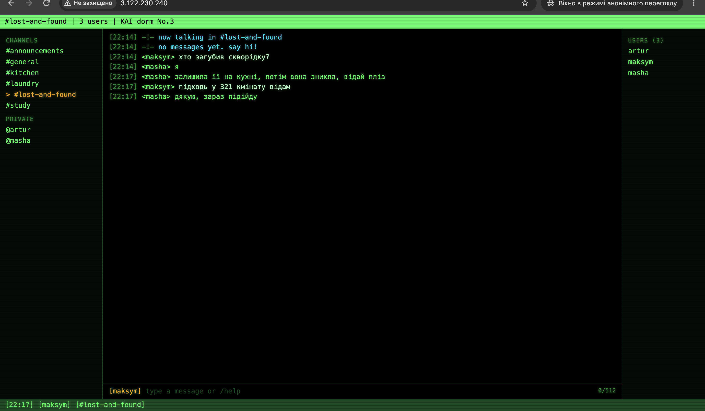
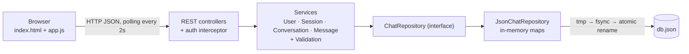

# dorm3 // relay chat

A retro IRC-style messenger for the students of **KAI dormitory No.3** (Kyiv Aviation Institute):
channels for the kitchen, the laundry and lost-and-found, private messages, and a green-on-black terminal look.

**Live demo:** http://3.122.230.240 — register any nick and join `#general`.



## Level

**Standard** + side quests:

- **Authentication** — passwords hashed with BCrypt, session tokens in HttpOnly cookies
- **Web UI** — chat layout served by the backend, polls for new messages every 2 seconds
- **Deployed** — runs on AWS EC2 as a systemd service, two devices can chat live

## Personal twist: a dorm chat that looks like 1995 IRC

The dorm already has a dozen Telegram groups where announcements drown in memes.
This messenger gives every topic its own IRC-style channel (`#kitchen`, `#laundry`,
`#lost-and-found`, `#study`, `#announcements`) and keeps the look of classic IRC clients like irssi:

- `[21:04] <artur> who took my pot?` line format, a color per nick, mentions highlighted
- slash commands: `/join #kitchen`, `/msg olena hi`, `/create #floor-3 olena taras`, `/search laundry`, `/users`, `/help`
- the **512-character limit** per message comes from IRC itself: RFC 1459 caps a protocol line at 512 bytes

## Tech stack

Java 21 · Spring Boot 4.1 · Jackson 3 · Gradle · plain HTML/CSS/JavaScript (no frameworks) · AWS EC2 (Amazon Linux 2023)

## Run it locally

Requires JDK 21.

```bash
git clone <this repo>
cd mini-messenger
./gradlew bootRun
```

Open http://localhost:8080, press **[ register ]** with any nick (3–20 chars, `a-z 0-9 _`) and a password (8+ chars).
You land in `#general` — type a message and press Enter. Open a second browser window (incognito) to chat as another user.

Run the tests:

```bash
./gradlew test
```

## How data is stored

All data — users, conversations and messages — lives in **one JSON file**, `data/db.json`
(`/var/lib/dorm3/db.json` on the server). `JsonChatRepository` reads it **once at startup** into in-memory maps,
and every read is served from memory. Every change (new user, new channel, new message) is written to disk
**before** the API answers, so a message the user saw as sent is already on disk.

Writes are **atomic**: the whole database is serialized to `db.json.tmp`, flushed to the physical disk with
`fsync`, and then renamed over `db.json` with an atomic `rename`. A crash in the middle of a write leaves the
old `db.json` untouched — you either get the old version or the new one, never half a file.
If the write fails (disk full, no permissions), the in-memory change is **rolled back** and the API returns
`503`, so memory and disk never disagree.

Edge cases:

- **File missing** → a fresh empty database is created on startup.
- **File corrupted** (for example, a bad hand edit) → it is moved aside to `db.json.corrupt-<timestamp>`
  and the app starts with an empty database instead of crashing; nothing is deleted.
- **Two messages in the same millisecond** → each message gets a per-conversation sequence number `seq`
  (1, 2, 3…) assigned under a lock, and history is sorted by `(createdAt, seq)`, so the order is always deterministic.
- **Timestamps** are stored in UTC (`Instant`) and converted to local time only in the browser.

Passwords are never stored — only BCrypt hashes (the salt is part of the hash).
Sessions are kept in memory on purpose: after a server restart users log in again, but no messages are lost.

All storage goes through the `ChatRepository` interface, so services don't know it's JSON —
a `SqliteRepository` could replace it without touching the rest of the code.

## Validation rules

| Field | Rule | Why |
|---|---|---|
| Message | not empty after trimming | an empty line is never a real message |
| Message | max **512 characters** (emoji count as one) | IRC's historical line limit; keeps the chat readable |
| Message | max 10 lines | stops one message from flooding the screen |
| Message | no control characters, no Unicode bidi overrides | protects storage and stops "reversed text" tricks that hide content |
| Username | 3–20 chars, `a-z 0-9 _`, case-insensitive, unique | IRC-style nicks, no look-alike or invisible characters |
| Password | 8+ characters, max 72 bytes | 72 bytes is the BCrypt input limit — longer would be silently truncated |
| Channel name | `#` + 2–30 chars `a-z 0-9 _ -` | IRC channel naming |
| Search query | 2–100 characters | 1-character searches return everything |

Validation happens **on the server** (`Validation` class), not only in the browser — the UI can be bypassed with `curl`.
Errors come back as JSON with a clear message, e.g. `400 {"message": "Message cannot be empty"}`.
Users can only read and write in conversations they are members of (`403` otherwise).

## Architecture



```
src/main/java/maiboroda/dev/
  model/      User, Conversation, Message — immutable records
  storage/    ChatRepository interface, JsonChatRepository, DatabaseSnapshot
  service/    business rules and validation, no HTTP code
  web/        REST controllers, session cookies, error handling
  config/     beans and default channels
src/main/resources/static/   the IRC-style web client
deploy/                      systemd unit + server setup script
```

## API

| Method | Path | Description |
|---|---|---|
| POST | `/api/auth/register` | create a user and log in |
| POST | `/api/auth/login` | log in (sets `dorm3_session` cookie) |
| POST | `/api/auth/logout` | log out |
| GET | `/api/auth/me` | current user |
| GET | `/api/users` | all users |
| GET | `/api/conversations` | my channels and private chats |
| GET | `/api/channels` | all channels, with `joined` flag |
| POST | `/api/channels` | create a channel `{name, members[]}` |
| POST | `/api/channels/{name}/join` | join a channel |
| POST | `/api/direct` | open a private chat `{username}` |
| GET | `/api/conversations/{id}/messages?after=&limit=` | history / new messages since `seq` |
| POST | `/api/conversations/{id}/messages` | send `{text}` |
| GET | `/api/messages/search?q=` | search my messages |

## Deployment

The app runs on an AWS EC2 `t3.micro` (Amazon Linux 2023, Java 21 Corretto) as a systemd service
that restarts automatically after a crash or reboot. Data lives in `/var/lib/dorm3`, outside the app folder,
so redeploys never touch it.

```bash
./gradlew bootJar
scp -i ~/.ssh/dorm3.pem build/libs/dorm3.jar deploy/setup.sh deploy/dorm3.service ec2-user@<ip>:~
ssh -i ~/.ssh/dorm3.pem ec2-user@<ip> 'sudo bash ~/setup.sh'
```

Crash test: `sudo systemctl kill -s KILL dorm3` — systemd brings the app back in 5 seconds and every message is still there.

## Known limitations and next steps

- Polling instead of WebSockets — simple and reliable, but adds up to 2 s delay. Next step: WebSockets.
- The whole database is rewritten on every change — fine for a dorm, not for millions of messages.
  Next step: SQLite or PostgreSQL with an index on `(conversation_id, seq)`.
- Sessions are lost on restart. Next step: persist sessions or use signed tokens.
- No HTTPS yet. Next step: a domain + Let's Encrypt behind nginx.

## Author

Artur Maiboroda — solo project, KAI, 2026.
